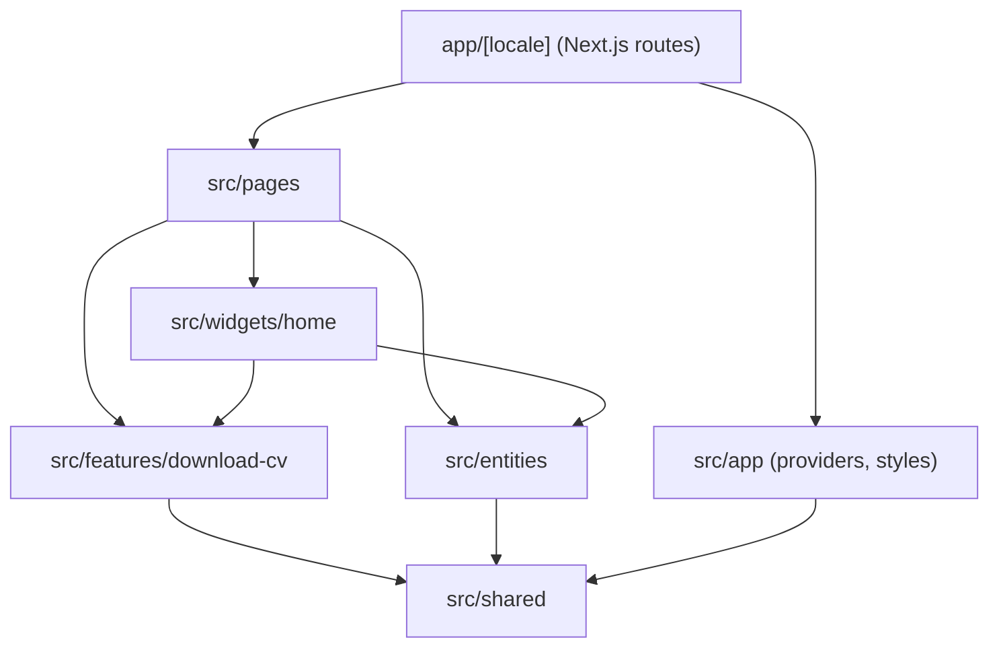
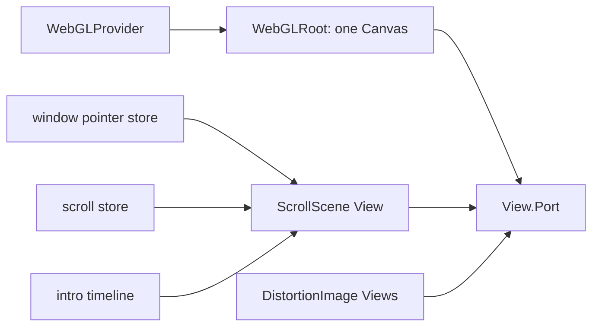

# Architecture

The project follows [Feature-Sliced Design](https://feature-sliced.design/).
Next.js owns routing through the root `app/` directory, while the FSD layers
live in `src/`.

Imports only ever point downwards. Each slice exposes a public API through its
`index.ts`, and Steiger rejects violations (`pnpm lint:fsd`).

## Layers

| Layer      | Location       | Responsibility                                              |
| ---------- | -------------- | ----------------------------------------------------------- |
| `app`      | `src/app`      | Global providers and styles, no business logic              |
| `pages`    | `src/pages`    | One slice per route, composing widgets into a screen        |
| `widgets`  | `src/widgets`  | Self-contained page blocks, here the whole home composition |
| `features` | `src/features` | User interactions: downloading the CV, opening a project    |
| `entities` | `src/entities` | Business data: `profile` and `project`                      |
| `shared`   | `src/shared`   | Reusable UI, libraries, configuration and i18n              |

The home page sections (hero, about, skills, experience, projects, contact,
header and the scroll scene) live together in the `home` widget rather than as
separate widgets. FSD treats a slice that has only one consumer as a candidate
for merging, and Steiger enforces that, so sections that exist only for the
home page stay inside it. `open-project` is the exception: it is a user
action, and the project card must not know about the transition, so the slice
stays even with a single caller.

## Routing and i18n

`app/[locale]/layout.tsx` is the root layout: it renders `<html>` and `<body>`,
validates the locale and mounts the providers. Because the locale segment sits
above the root layout, `next/root-params` exposes it everywhere, which is what
lets `src/shared/i18n/request.ts` resolve the locale during static rendering
without reading request headers.

`src/proxy.ts` runs the next-intl middleware that redirects `/` to the default
locale and negotiates the locale. See
[ADR 0005](adr/0005-next-intl-i18n.md).

## The single WebGL canvas

`WebGLRoot` renders one fixed `<Canvas>` with a `<View.Port />`. Every 3D
element on the page is a `<View>` bound to a DOM node that tracks its position,
so the background scene and the project screenshots all share a single WebGL
context. Multiple canvases would mean multiple contexts, which browsers cap and
which cost memory. See [ADR 0003](adr/0003-single-webgl-canvas-with-views.md).

`WebGLProvider` skips the canvas entirely when the user prefers reduced motion,
and the image components render a plain `next/image` instead.

## From scroll to scene

`SmoothScrollProvider` only drives Lenis from the GSAP ticker and forwards each
scroll to ScrollTrigger. The stage itself is measured by `useStageTracker`,
which the home scene mounts so the section list is collected again every time
the home page mounts. Positions are cached and refreshed on
`ScrollTrigger.refresh`, not on every scroll event. The probe is the top of the
viewport, so the hero starts at stage `0` instead of halfway through the first
section.

The tracker writes two values into the scroll store:

- `progress`, the overall page position from 0 to 1.
- `stage`, a fractional index. The integer part is the current section and the
  fraction is the transition towards the next one. Sections are the elements
  carrying a `data-stage` attribute, which `Section` sets from its `id`.

`MorphParticles` reads that store inside `useFrame` through `getState()`, so the
animation never triggers a React render. The vertex shader blends the two
neighbouring target shapes by the fractional part of `stage`, which means the
whole morph runs on the GPU. See
[ADR 0004](adr/0004-gpu-particle-morphing.md).

Pointer position is a separate Zustand store. `usePointerTracking` listens for
`pointermove` on `window` and stores normalized device coordinates. The canvas
itself is `pointer-events: none`, so listening on the canvas never receives the
event.

On the home page, `SceneRig` shifts the particle group to the right of the text
from 1024px up, scales it down and fades it on narrower screens, and tilts it
toward the cursor with a slow idle spin. An intro timeline eases `uIntro` from
0 to 1 so the points gather from a scattered cloud into the hero sphere; with
reduced motion that value is 1 immediately. Glow is a bright core plus a soft
halo in the fragment shader, not a postprocessing pass. See
[ADR 0007](adr/0007-shader-glow-over-postprocessing.md).

Headings use `RevealText` (GSAP SplitText) and blocks use `Reveal`. A custom
cursor and magnetic buttons run only for a fine pointer and are skipped when
the user prefers reduced motion.

The pointer store works the same way: `WebGLRoot` writes normalized pointer
coordinates, and the shader repels particles around the projected cursor
position.

## Opening a project

Clicking a project card does not navigate immediately. `useOpenProject` passes
the card element to `playPageTransition`. That function lives in
`shared/lib/page-transition` and knows nothing about projects: it stores the
card rectangle and drives one GSAP timeline of about 1.5s. Particles leave the
current shape together, then spiral clockwise toward a wide rounded loop
around the card. The loop bends through the corners in that same direction, so
the stream does not reverse or break. The approach stays loose, and the page
covers the screen before the whirl can settle into a line.
While that happens, every sibling around the card fades out, so the header,
the other sections and the neighbouring card disappear, and the clicked card
stays. Elements marked `data-transition-keep` (the canvas, the overlay and
the cursor) are left alone. The card image's WebGL plane hides for the same
stretch, otherwise a faded neighbour would show the distortion mesh through
the shared canvas. Near the end, `overlay` covers the screen with the page
background and only then does `router.push` open the case.

On the next pathname the overlay fades out and `endPageTransition` clears the
inline opacities and the store. Going back from a case has no animation.

The animation is skipped, and the link behaves normally, when the user prefers
reduced motion, when WebGL is off, or when the click asks for a new tab
(Ctrl, Cmd, Shift, Alt, or the middle button). A second click while a
transition is already running is ignored.

## Case studies

Case studies are MDX files in `content/projects/<slug>/<locale>.mdx`. They are
not routed by Next.js directly. `getProjectCase` reads the file and evaluates it
with `@mdx-js/mdx` on the server, returning the compiled component and the
exported `metadata`. The page at `app/[locale]/projects/[slug]` enumerates every
slug and locale in `generateStaticParams`, so the result is static HTML. See
[ADR 0006](adr/0006-mdx-case-studies.md).
